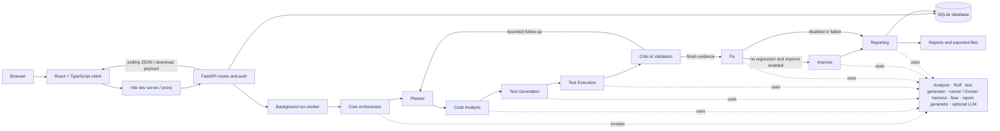
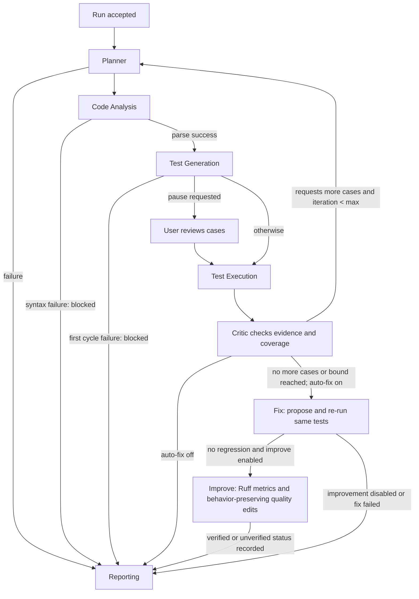

# System Architecture

## Component view

The browser client is a React single-page application. It calls the FastAPI JSON API through the Vite development proxy. The API validates requests, enforces optional authentication/ownership, stores run metadata, and schedules work in a background worker. The worker invokes the synchronous orchestrator. Domain tools provide AST/Ruff analysis, test generation, the configured isolated test runner, fix verification, reports, and optional LLM integration. SQLite stores accounts, sessions, runs, events, cases, results, findings, reports, and verified-fix memory. Download responses are typed payloads; batch output uses ZIP export.

Rendered vector companion: [architecture.svg](architecture.svg). The workflow routing details are in [Agents and Orchestration](CA3_AGENTS_AND_ORCHESTRATION.md). The frontend API route table and method/path checker are in `scripts/check_frontend_routes.py`; live response-schema verification is recorded in [endpoint verification](ENDPOINT_VERIFICATION.md).

## Decision flow

The decision nodes correspond to `next_stage` and `_fix_or_report` in `core/workflow.py`. The orchestrator increments the iteration only when routing back to Planner; follow-up test generation must add new cases or the run moves to Reporting.

## Request lifecycle

1. The React UI submits source, optional requirements, and run options to `POST /api/runs`.
2. FastAPI authenticates/authorizes the caller, persists run metadata, and dispatches the background task. The UI polls status, event, and result routes.
3. The orchestrator creates agent records and executes conditional workflow transitions. Each agent writes structured evidence to shared run state and records tool calls.
4. The configured runner executes generated cases in Docker by default. Local trusted execution requires an explicit server setting and is not a sandbox; disabled or unavailable execution does not create passed tests.
5. The Fix agent compares outcomes on the original and candidate source. If enabled and no regression occurred, Improve applies measured quality edits and reruns the same tests. Reporting persists original, fixed, and improved artifacts, metrics, findings, and verification status.

## Trust boundaries

Browser code is untrusted input. API authentication/ownership and schema validation protect service operations. Submitted code must be treated as untrusted: Docker mode is the recommended execution boundary; local trusted mode is explicitly not a sandbox. The API process delegates execution to the runner. Optional remote model calls require administrator configuration and explicit consent, while the no-LLM deterministic mode sends no source to a remote provider.
