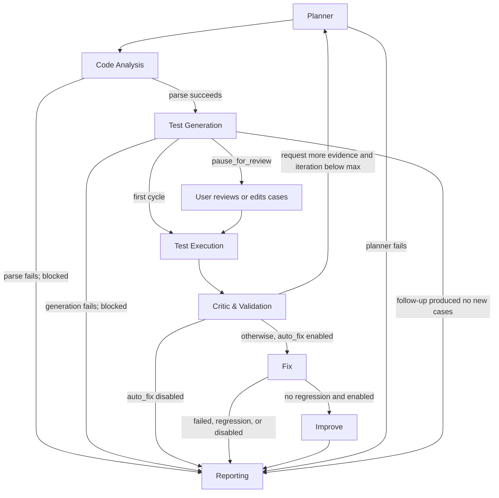

# Agents and Orchestration

## Eight agents

The registry in `core/orchestrator.py` runs seven agents in this order. The `AgentContext.tool` wrapper records each tool name, summary, result, success flag, and duration in the agent record.

| Agent | Responsibility | Main input/output and tools |
|---|---|---|
| Planner | Reads objective, requirements, requested targets, categories, and available tools; builds a run plan. On a follow-up cycle it focuses on functions requested by the Critic. | Calls `sandbox_status` and checks Ruff availability; records plan, focus, and iteration cap. |
| Code Analysis | Parses source and collects function/class structure, metrics, static findings, and Ruff output. | `tools.code_analyzer.analyze_source`; syntax errors block test stages and continue to reporting. |
| Test Generation | Builds normal, boundary, edge, negative, requirement, and doctest cases; a follow-up cycle adds distinct cases for requested functions. | `tools.test_generator.generate_cases`; optional LLM proposals only when configured and consented. |
| Test Execution | Runs enabled test cases and captures actual status, output, exception, and timing. | `tools.test_runner.run_cases` through the configured sandbox; unavailable execution remains blocked/not-run. |
| Critic & Validation | Groups reproduced failures, separates confirmed expectations from heuristic checks, assesses coverage, and may request one bounded extra cycle. | Rule-based evidence evaluation; optional LLM review when enabled. |
| Fix | Applies known deterministic edits, then re-runs the same tests. It accepts a candidate only if previously passing tests still pass and, for smart/AI candidates, failures decrease. | `tools.fixer` patch tools and `run_cases`; optional AI rewrites for confirmed failures. Reports accepted and skipped proposals with a diff. |
| Improve | Runs only after a successful Fix stage when “Also improve code quality” is enabled. Ruff rules F401/F541/UP032 and formatting run first; detected local Ollama may propose a bounded readability rewrite. Candidate signatures are preserved, unsafe additions rejected, and the same tests rerun. | `tools.code_improver`; Ruff issue/format counts, function and type-hint/docstring coverage, and AST cyclomatic complexity; results and source versions persist in SQLite. An unavailable runner is labelled unverified. |
| Reporting | Merges and deduplicates static and test findings, assigns IDs, builds the report, and persists it. | `tools.report_generator.build_report`, SQLite, JSON/CSV/HTML exports. |

## Workflow and transition rules

`core/workflow.py` is the transition authority. The default maximum is two iterations (configurable up to five). A follow-up is requested only if the Critic finds failing or thinly tested functions and has not exhausted the iteration bound. Test generation on later iterations must produce new cases or the workflow proceeds to Reporting. A pause-for-review option stops after initial generation and resumes at execution when the user continues. Execution errors do not become passing results. Agent exceptions are recorded as failed stages; syntax/generation failures mark the run blocked and still produce a report where possible.

## What is cooperative

Agents share a `RunState` and pass evidence through structured fields: plan, analysis, cases, results, critic summary, fixes, improvements, and report. The Critic's requested functions control the optional additional Planner → Generator → Execution → Critic cycle. Fix consumes actual test outcomes and returns a proposed patched source plus verification evidence. Improve runs only after a non-regressing fix and records original, fixed, and improved code, diffs, metrics, verification, and changes. If test execution is unavailable, the improvement is unverified. Reporting collects the outputs. Tool calls are visible in each agent's record. This is a bounded sequential orchestrator with conditional routing, not eight independent processes or a free-form agent conversation.
